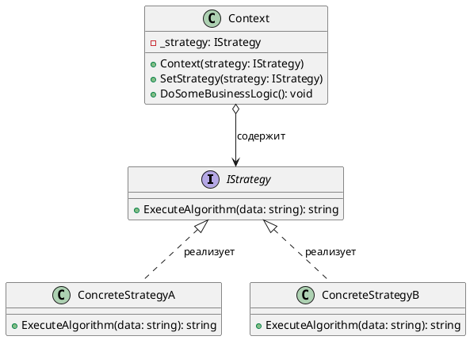
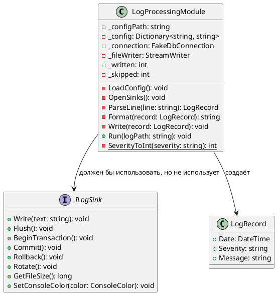
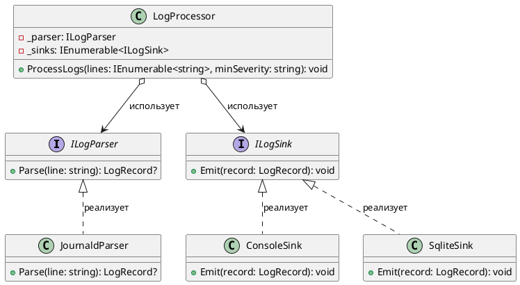

# Лабораторная работа 4. Git, среда и SOLID

**Студент:** Захарова Кристина, БИСО-01-24

**Вариант:** 16 — Journald export, приёмники: Консоль, SQLite (Особое требование: разбор unit и приоритета)

**Репозиторий:** https://github.com/k8839480-cmyk/Lecture_Examples

**Pull Request:** <вставьте_ссылку_на_PR_перед_сдачей>

---

## Задача

Настроить рабочий процесс в Git с непрерывной интеграцией (CI). 
Прочитать и проанализировать реализацию паттерна в чужом коде. 
Найти нарушения принципов SOLID в классе `LogProcessingModule` (god-object) и провести его рефакторинг, разделив на независимые слои, чтобы добавление нового приёмника логов не требовало изменения существующих файлов.

---

## Ход работы

**Шаг 1. Настройка репозитория и каркаса**
Сделан форк учебного репозитория, настроен upstream. В корне создан solution `LogHub` с основным проектом (classlib) и тестовым (xunit). Настроен GitHub Actions для автоматической сборки (CI).

**Шаг 2. Анализ и рефакторинг антипаттерна God Object**
В ходе рефакторинга монолитного класса `LogProcessingModule` код был разбит на логические слои и распределен по новым папкам и файлам в проекте `LogHub`:

### 1. Создание моделей
Создана папка `Models`. В ней создан файл `LogRecord.cs`, в котором написан класс модели лога:

```csharp
using System;

namespace LogHub.Models;

public class LogRecord
{
    public DateTime Date { get; set; }
    public string Severity { get; set; } = string.Empty;
    public string Message { get; set; } = string.Empty;
}
```

### 2. Выделение интерфейсов (Соблюдение ISP)
Создана папка `Interfaces`. В ней созданы два файла для абстрагирования приёмников и парсеров:

Файл `ILogSink.cs`:
```csharp
using LogHub.Models;

namespace LogHub.Interfaces;

public interface ILogSink
{
    void Emit(LogRecord record);
}
```

Файл `ILogParser.cs`:
```csharp
using LogHub.Models;

namespace LogHub.Interfaces;

public interface ILogParser
{
    LogRecord? Parse(string line);
}
```

### 3. Создание приёмников (Консоль)
Создана папка `Sinks`. В ней создан файл `ConsoleSink.cs`, в котором реализована логика цветного вывода логов на экран:

```csharp
using System;
using LogHub.Interfaces;
using LogHub.Models;

namespace LogHub.Sinks;

public class ConsoleSink : ILogSink
{
    public void Emit(LogRecord record)
    {
        var previousColor = Console.ForegroundColor;
        
        if (record.Severity == "Error" || record.Severity == "Critical")
            Console.ForegroundColor = ConsoleColor.Red;
        else
            Console.ForegroundColor = ConsoleColor.Gray;

        Console.WriteLine($"{record.Date:yyyy-MM-dd HH:mm:ss} [{record.Severity}] {record.Message}");
        Console.ForegroundColor = previousColor;
    }
}
```

### 4. Создание парсера (Journald export)
Создана папка `Parsers`. В ней создан файл `JournaldParser.cs`. Написан код парсера под формат Journald (согласно требованиям варианта 16) с извлечением приоритета и юнита:

```csharp
using System;
using LogHub.Interfaces;
using LogHub.Models;

namespace LogHub.Parsers;

public class JournaldParser : ILogParser
{
    public LogRecord? Parse(string line)
    {
        if (string.IsNullOrWhiteSpace(line)) return null;
        
        var record = new LogRecord { Date = DateTime.Now };

        if (line.Contains("PRIORITY=3")) record.Severity = "Error";
        else if (line.Contains("PRIORITY=4")) record.Severity = "Warning";
        else if (line.Contains("PRIORITY=6")) record.Severity = "Info";
        else record.Severity = "Debug";

        string unitName = "Система";
        var unitIndex = line.IndexOf("_SYSTEMD_UNIT=");
        if (unitIndex != -1)
        {
            var start = unitIndex + 14;
            var end = line.IndexOf(' ', start);
            unitName = end == -1 ? line.Substring(start) : line.Substring(start, end - start);
        }

        var msgIndex = line.IndexOf("MESSAGE=");
        if (msgIndex != -1)
            record.Message = $"[{unitName}] {line.Substring(msgIndex + 8)}";
        else
            record.Message = line;

        return record;
    }
}
```

### 5. Создание класса-оркестратора (Соблюдение DIP и OCP)
В корне проекта `LogHub` создан файл `LogProcessor.cs`. Главный класс принимает интерфейсы через конструктор (внедрение зависимостей):

```csharp
using System;
using System.Collections.Generic;
using LogHub.Interfaces;

namespace LogHub;

public class LogProcessor
{
    private readonly ILogParser _parser;
    private readonly IEnumerable<ILogSink> _sinks;

    public LogProcessor(ILogParser parser, IEnumerable<ILogSink> sinks)
    {
        _parser = parser;
        _sinks = sinks;
    }

    public void ProcessLogs(IEnumerable<string> lines, string minSeverity)
    {
        int minLevel = minSeverity == "Info" ? 1 : 0; 
        int written = 0, skipped = 0;

        foreach (var line in lines)
        {
            var record = _parser.Parse(line);
            if (record == null) { skipped++; continue; }

            foreach (var sink in _sinks)
            {
                sink.Emit(record);
            }
            written++;
        }
        Console.WriteLine($"\n[Система] Обработка завершена. Записано: {written}, пропущено: {skipped}");
    }
}
```

### 6. Подключение базы данных SQLite
Через терминал установлена библиотека: `dotnet add LogHub/LogHub.csproj package Microsoft.Data.Sqlite`.
В папке `Sinks` создан файл `SqliteSink.cs`, который при инициализации создаёт таблицу, а в `Emit` выполняет SQL-запрос `INSERT`:

```csharp
using Microsoft.Data.Sqlite;
using LogHub.Interfaces;
using LogHub.Models;

namespace LogHub.Sinks;

public class SqliteSink : ILogSink
{
    private readonly string _connectionString;

    public SqliteSink(string dbPath = "logs.db")
    {
        _connectionString = $"Data Source={dbPath}";
        using var connection = new SqliteConnection(_connectionString);
        connection.Open();
        var command = connection.CreateCommand();
        command.CommandText = @"CREATE TABLE IF NOT EXISTS Logs (Id INTEGER PRIMARY KEY AUTOINCREMENT, Date TEXT, Severity TEXT, Message TEXT)";
        command.ExecuteNonQuery();
    }

    public void Emit(LogRecord record)
    {
        using var connection = new SqliteConnection(_connectionString);
        connection.Open();
        var command = connection.CreateCommand();
        command.CommandText = "INSERT INTO Logs (Date, Severity, Message) VALUES ($date, $severity, $message)";
        command.Parameters.AddWithValue("$date", record.Date.ToString("O"));
        command.Parameters.AddWithValue("$severity", record.Severity);
        command.Parameters.AddWithValue("$message", record.Message);
        command.ExecuteNonQuery();
    }
}
```

### 7. Написание тестов
В тестовом проекте `LogHub.Tests` в файле `UnitTest1.cs` написан код проверки. Создан список из строк в формате Journald, инициализированы парсер и список приёмников (Консоль и БД). Команда `dotnet test` показала успешное прохождение теста:

```csharp
using System.Collections.Generic;
using Xunit;
using LogHub.Interfaces;
using LogHub.Parsers;
using LogHub.Sinks;

namespace LogHub.Tests;

public class LogProcessorTests
{
    [Fact]
    public void ProcessLogs_WithMultipleSinks_ShouldWork()
    {
        var logLines = new List<string>
        {
            "__REALTIME_TIMESTAMP=1609459200000000 PRIORITY=6 _SYSTEMD_UNIT=systemd MESSAGE=Система запущена",
            "__REALTIME_TIMESTAMP=1609459201000000 PRIORITY=3 _SYSTEMD_UNIT=nginx.service MESSAGE=Сбой подключения",
            "сломанная строка"
        };

        ILogParser parser = new JournaldParser();
        var sinks = new List<ILogSink> { new ConsoleSink(), new SqliteSink("test_logs.db") }; 
        var processor = new LogProcessor(parser, sinks);

        var exception = Record.Exception(() => processor.ProcessLogs(logLines, "Info"));
        Assert.Null(exception);
    }
}
```

---

## Таблица нарушений SOLID в старом коде

| Принцип | Строка | Почему нарушен (в чём проблема) |
|---|---|---|
| **SRP** | 30 (`class LogProcessingModule`) | Класс выполняет сразу 6 независимых задач: чтение конфигурации, управление БД, парсинг строк, форматирование, фильтрацию и маршрутизацию. Изменение любого требования затрагивает один и тот же файл. |
| **OCP** | 116 (`switch (_config["sink"])`) | Чтобы добавить новый приёмник логов, придётся модифицировать существующий код: дописывать новые ветки `case` в методы `Write` и `OpenSinks`. |
| **LSP** | 219 (`interface ILogSink`) | Если консольный приёмник будет реализовывать этот интерфейс, он будет вынужден выбрасывать `NotImplementedException` при вызове `BeginTransaction()` или `Rotate()`. Вызывающий код, ожидающий корректной работы `ILogSink`, упадёт. |
| **ISP** | 219 (`interface ILogSink`) | «Толстый» интерфейс навязывает реализациям методы, которые им не нужны. База данных ничего не знает о `SetConsoleColor`, а консоль — о `Rollback`. |
| **DIP** | 169 (`File.ReadLines`) и 34 (`_connection`) | Бизнес-логика напрямую зависит от конкретных низкоуровневых классов (`StreamWriter`, `FakeDbConnection`) и статического доступа к диску. Из-за этого модуль невозможно протестировать без реального файла на диске. |

---

## Диаграммы классов

### 1. Разбор чужого кода (Паттерн Стратегия)
```
@startuml
interface IStrategy {
    + ExecuteAlgorithm(data: string): string
}

class ConcreteStrategyA {
    + ExecuteAlgorithm(data: string): string
}

class ConcreteStrategyB {
    + ExecuteAlgorithm(data: string): string
}

class Context {
    - _strategy: IStrategy
    + Context(strategy: IStrategy)
    + SetStrategy(strategy: IStrategy)
    + DoSomeBusinessLogic(): void
}

Context o--> IStrategy : содержит
IStrategy <|.. ConcreteStrategyA : реализует
IStrategy <|.. ConcreteStrategyB : реализует
@enduml
```


### 2. God-класс ДО рефакторинга
```
@startuml
class LogProcessingModule {
    - _configPath: string
    - _config: Dictionary<string, string>
    - _connection: FakeDbConnection
    - _fileWriter: StreamWriter
    - _written: int
    - _skipped: int
    - LoadConfig(): void
    - OpenSinks(): void
    - ParseLine(line: string): LogRecord
    - Format(record: LogRecord): string
    - Write(record: LogRecord): void
    + Run(logPath: string): void
    - {static} SeverityToInt(severity: string): int
}

interface ILogSink {
    + Write(text: string): void
    + Flush(): void
    + BeginTransaction(): void
    + Commit(): void
    + Rollback(): void
    + Rotate(): void
    + GetFileSize(): long
    + SetConsoleColor(color: ConsoleColor): void
}

class LogRecord {
    + Date: DateTime
    + Severity: string
    + Message: string
}

LogProcessingModule --> LogRecord : создаёт
LogProcessingModule --> ILogSink : должен бы использовать, но не использует
@enduml
```


### 3. Система ПОСЛЕ рефакторинга
```
@startuml
interface ILogParser {
    + Parse(line: string): LogRecord?
}

interface ILogSink {
    + Emit(record: LogRecord): void
}

class LogProcessor {
    - _parser: ILogParser
    - _sinks: IEnumerable<ILogSink>
    + ProcessLogs(lines: IEnumerable<string>, minSeverity: string): void
}

class JournaldParser {
    + Parse(line: string): LogRecord?
}

class ConsoleSink {
    + Emit(record: LogRecord): void
}

class SqliteSink {
    + Emit(record: LogRecord): void
}

LogProcessor o--> ILogParser : использует
LogProcessor o--> ILogSink : использует
ILogParser <|.. JournaldParser : реализует
ILogSink <|.. ConsoleSink : реализует
ILogSink <|.. SqliteSink : реализует
@enduml
```



---

## Применённые паттерны

| Паттерн | Где применён | Почему именно он |
|---|---|---|
| Стратегия / Внедрение зависимостей | `ILogParser` и `ILogSink` в `LogProcessor` | Источников и форматов может быть несколько. Без выделения интерфейсов-стратегий в `LogProcessor` остался бы `switch`, который пришлось бы править при каждом новом источнике (нарушение OCP). Выбор реализации теперь делается при сборке приложения. |

---

## Ключевые решения

- Выделены независимые узкие интерфейсы `ILogParser` и `ILogSink` вместо одного универсального. Это решило проблему "толстого" интерфейса (ISP).
- Класс `LogProcessor` теперь получает зависимости через конструктор (DIP), что позволило написать Unit-тест с передачей списка строк прямо в коде, не создавая физические файлы на диске.
- Для SQLite применён отдельный класс-приёмник, который инкапсулирует логику создания таблиц и SQL-запросов, освобождая процессор логов от логики работы с БД (SRP).

---

## Тесты

Всего тестов: 1. Покрыт основной сценарий обработки валидных и невалидных логов с одновременной записью в два приёмника (Консоль и SQLite).

```
$ dotnet test
Сводка теста: всего: 1; сбой: 0; успешно: 1; пропущено: 0; длительность: 2,0 с
```

---
## Что не получилось

- Настройка GitHub Actions (CI) получилась не с первого раза. Пайплайн падал с ошибкой при сборке, так как пути к файлу решения (`.sln`) в `.yml` скрипте не совпадали с реальной структурой папок в репозитории. Пришлось сделать пару дополнительных коммитов, чтобы отладить пути.
- При подключении базы данных SQLite программа при первом запуске стала выдавать исключение `SQLite Error 1: 'no such table: Logs'`. Не сразу стало понятно, что пакет сам не генерирует схему базы. Проблему решила добавлением SQL-запроса `CREATE TABLE IF NOT EXISTS` прямо в конструктор `SqliteSink`.


---

## Источники

- Разбор принципа работы паттерна «Стратегия» и теории SOLID опирался на материалы сайта Refactoring.Guru.
- файл практической работы 